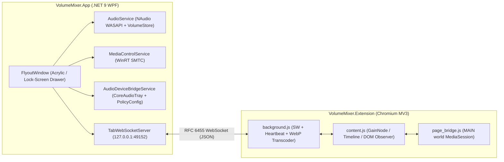

[English](README.md) | [Русский](README.ru.md)

# Volume Mixer for Windows 11

[](https://github.com/Tryharder782/windows-volume-mixer/actions/workflows/build.yml)
[](https://github.com/Tryharder782/windows-volume-mixer/releases/latest)
[](https://dotnet.microsoft.com/)
[](https://www.microsoft.com/windows)
[](VolumeMixer.Extension/manifest.json)
[](LICENSE)

A lightweight, minimalist Windows 11 volume mixer flyout inspired by macOS Control Center. Adjust per-application WASAPI volume, independently control individual Chromium browser tabs, scrub media from a collapsible lock-screen player drawer, and switch audio profiles via an optional `CoreAudioTray` bridge — without stealing focus or raising the taskbar over borderless fullscreen games.

---

## Features

- **Windows 11 Acrylic & Mica Glassmorphism**: Uses `SetWindowCompositionAttribute` (`ACCENT_ENABLE_ACRYLICBLURBEHIND` / `ACCENT_ENABLE_BLURBEHIND`) so translucent blur stays active even when the overlay is unfocused.
- **macOS Control Center UX**: Thick pill sliders with mouse-wheel support, smooth `CubicEase` transitions for opening, panels, drawers, and toggles, occupying roughly ~10% of the screen above the system tray.
- **Game-Friendly Non-Activating Overlay**: Shown with `WS_EX_NOACTIVATE` and dismissed via a scoped `WH_MOUSE_LL` outside-click hook (only active while open) so borderless fullscreen games never lose focus or trigger the Windows taskbar.
- **Per-App WASAPI Mixer**: Groups audio sessions by process, caches executable icons and friendly `FileDescription` names, and persists per-app volume/mute state across sessions (`%LocalAppData%\VolumeMixer\volumes.json`).
- **Per-Tab Chromium Audio Control**: Pairs with a Manifest V3 extension (Chrome, Edge, Brave, Opera, Vivaldi, Yandex) over a zero-admin loopback RFC 6455 WebSocket server (`127.0.0.1:49152`):
  - Uses Web Audio API `GainNode` (immune to YouTube Stable Volume resets) with automatic fallback to `HTMLMediaElement.volume` for cross-origin media without CORS.
  - Displays each tab's own favicon (supporting HTTP/HTTPS and base64 data URIs) and transcodes `.webp` / `.avif` thumbnails in-browser for WPF.
  - Keeps MV3 service workers alive via a 20s ping/pong heartbeat and starts every newly opened tab at `100%` volume.
- **Collapsible Lock-Screen Media Player (`▾` / `▴`)**: Hidden by default on every playable app (via Windows SMTC) and browser tab (via `navigator.mediaSession`). Expands to reveal album/video artwork, title, artist/channel, crisp vector `Prev / Play-Pause / Next` buttons, `LIVE` indicator for streams, and commit-on-release timeline scrubbing.
- **Customizable Global Hotkeys & Autostart**: Built-in hotkey recorder for Toggle Mixer (default `Ctrl + Shift + V`), Master Mute, and Active Window Mute, plus silent `--tray` Windows autostart and desktop-scoped single-instance wakeup.
- **`CoreAudioTray` Profile Bridge**: Reads `%AppData%\CoreAudioTray\config.json` to provide one-click **Headphones** / **Speakers** profile switching and a split **Output / Microphone** selector using `IPolicyConfig`, with locked profile restoration on startup.
- **Low Resource Footprint**: Zero background UI polling timers when minimized to the tray.

---

## Architecture



---

## Quick Start

### Option A: Download Prebuilt Release (Recommended)

1. Ensure the **.NET 9 Desktop Runtime (x64)** is installed ([download from Microsoft](https://dotnet.microsoft.com/download/dotnet/9.0)).
2. Download `VolumeMixer-v1.0.0-win-x64.exe` and `VolumeMixer-Extension-v1.0.0.zip` from the [Latest Release](https://github.com/Tryharder782/windows-volume-mixer/releases/latest).
3. Place `VolumeMixer-v1.0.0-win-x64.exe` in a permanent folder (e.g., `C:\Tools\VolumeMixer\VolumeMixer.exe`) and run it — press `Ctrl + Shift + V` or click the tray icon to open the mixer.
4. *(Optional)* Extract `VolumeMixer-Extension-v1.0.0.zip` and load the browser extension (see below).

### Option B: Build from Source

**Prerequisites**: Windows 10 (build 22621+) or Windows 11, [.NET 9 SDK](https://dotnet.microsoft.com/download/dotnet/9.0).

```powershell
git clone https://github.com/Tryharder782/windows-volume-mixer.git
cd windows-volume-mixer

# Build solution
dotnet build VolumeMixer.sln -c Release

# Or publish a standalone single-file executable
dotnet publish VolumeMixer.App/VolumeMixer.App.csproj -c Release -r win-x64 -p:PublishSingleFile=true -p:IncludeNativeLibrariesForSelfExtract=true --self-contained false -o publish
```

### Browser Extension Setup (Per-Tab Audio)

1. Open `chrome://extensions` (or `brave://extensions`, `edge://extensions`, `opera://extensions`).
2. Enable **Developer mode**.
3. Click **Load unpacked** and select the `VolumeMixer.Extension` folder (or the extracted `VolumeMixer-Extension-v1.0.0.zip` folder). You can copy the path directly from the app's **Settings** tab via **"Копировать путь к расширению"**.

---

## Configuration & File Locations

| File | Purpose |
| :--- | :--- |
| `%LocalAppData%\VolumeMixer\settings.json` | Global hotkeys, backdrop mode (`Acrylic` / `Mica`), `RunAtStartup`, `WebSocketPort` (`49152`). |
| `%LocalAppData%\VolumeMixer\volumes.json` | Saved per-application volume/mute states and `LockedProfile` (`headset` / `speakers`). |
| `%AppData%\CoreAudioTray\config.json` | Optional external profile config read/synced by the `CoreAudioTray` device bridge. |

---

## Project Structure

```text
├── .github/workflows/build.yml          # GitHub Actions CI (.NET 9 build + JS validation)
├── VolumeMixer.sln                      # Visual Studio / dotnet solution
├── VolumeMixer.App/                     # .NET 9 WPF desktop application
│   ├── Assets/VolumeMixer.ico           # Multi-resolution application icon
│   ├── Converters/                      # Pill fill width converter & commit-on-release drag behavior
│   ├── Models/                          # Settings, audio session, and browser tab models
│   ├── Services/                        # WASAPI, SMTC, WebSocket server, Win32, hotkeys, tray, bridge
│   ├── Themes/Styles.xaml               # Pill sliders, animated toggles, transport & seek styles
│   └── Views/                           # Acrylic flyout window & lock-screen media drawer UI
└── VolumeMixer.Extension/               # Chromium Manifest V3 extension
    ├── manifest.json                    # Extension manifest (MAIN + ISOLATED world scripts)
    ├── page_bridge.js                   # Captures MediaSession metadata & action handlers
    ├── content.js                       # GainNode volume scaling, timeline & playback control
    └── background.js                    # WebSocket client, 20s heartbeat & WebP/AVIF transcoder
```

---

## Known Limitations & Tips

- **DRM-Protected Video (Widevine)**: Sites such as Netflix may restrict Web Audio `GainNode` capture in JS; use the browser's main application slider for those tabs.
- **Exclusive Fullscreen Games**: Legacy games running in true Exclusive Fullscreen may minimize when any overlay opens. Use **Borderless Windowed** mode for seamless overlay support without taskbar popups.
- **Port Conflict (`49152`)**: If another service uses port `49152`, change `WebSocketPort` in `%LocalAppData%\VolumeMixer\settings.json` and `WS_URL` in `VolumeMixer.Extension/background.js`.

---

## License

Released under the [MIT License](LICENSE).
